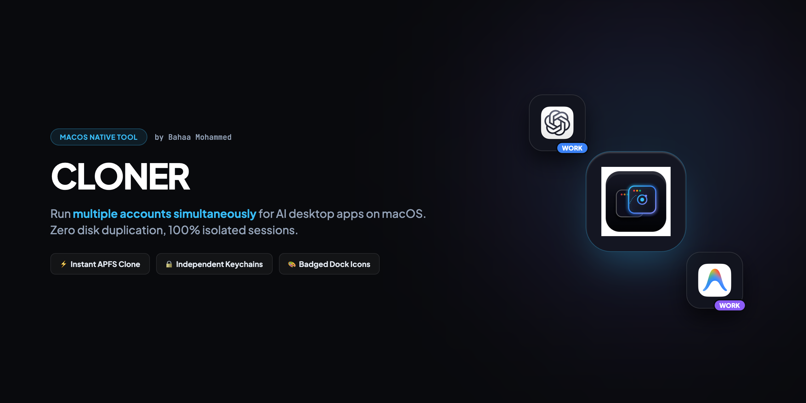
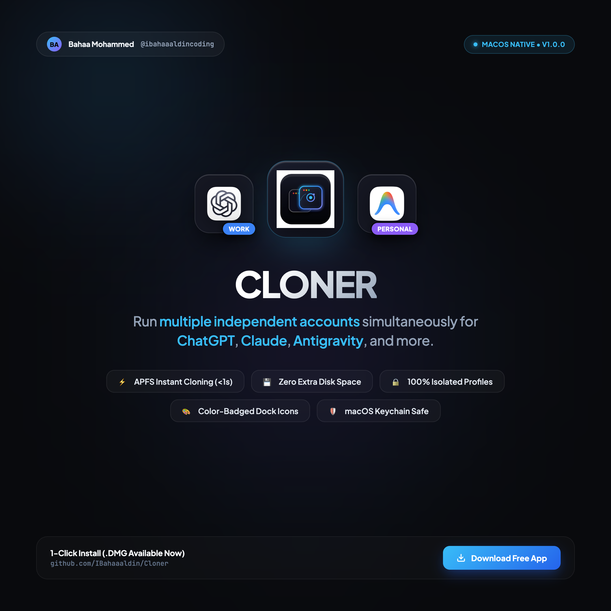
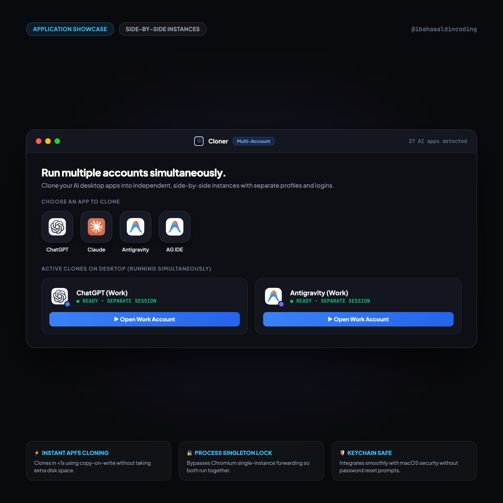

# 👥 Cloner for macOS

> Run multiple independent accounts simultaneously for AI desktop apps (ChatGPT, Claude, Antigravity, Codex, and more) with zero extra disk storage and completely separate profiles.



<div align="center">

[](https://github.com/IBahaaaldin/Cloner/releases/download/v1.0.0/Cloner.dmg)
[](https://apple.com)
[](https://apple.com)
[](LICENSE)

</div>

---

## 🌐 Visual Previews & Post Slides

| Slide 1: Editorial Cover (2160x2160) | Slide 2: In-Action App Showcase (2160x2160) |
| :---: | :---: |
|  |  |

*(High-resolution 2-slide post pack formatted for Instagram [@ibahaaaldincoding](https://www.instagram.com/ibahaaaldincoding))*

---

## ⚡ 1-Click Direct Installation

Anyone can download and install Cloner on their Mac in seconds:

1. **[Click here to download Cloner.dmg (v1.0.0)](https://github.com/IBahaaaldin/Cloner/releases/download/v1.0.0/Cloner.dmg)**
2. Double-click **`Cloner.dmg`** to open the disk image.
3. Drag **`Cloner.app`** into your **`Applications`** folder.
4. Launch **Cloner** from Spotlight (`Cmd + Space` → `Cloner`) or Launchpad.

```bash
# Or install via Terminal in one line:
curl -L -O https://github.com/IBahaaaldin/Cloner/releases/download/v1.0.0/Cloner.dmg && hdiutil attach Cloner.dmg && cp -R /Volumes/Cloner/Cloner.app /Applications/ && hdiutil detach /Volumes/Cloner
```

---

## ✨ Core Features

- **⚡ Instant APFS Cloning (<1s)**: Leverages Apple File System copy-on-write (`cp -cR`). A full application clone creates in under a second and takes **0 extra disk space**.
- **👥 Simultaneous Multi-Account Sessions**: Launch and keep your **Work** and **Personal** accounts open side-by-side at the same time. Never log out or switch profiles again.
- **🔒 True ProcessSingleton Isolation**: Overrides Chromium & Electron singleton sockets and profile directories, allowing multiple identical apps to run concurrently without redirecting focus to the main window.
- **🛡️ macOS Keychain & Privacy Safe**: Automatic Keychain linkage guarantees that macOS Security Services will never prompt you to reset your keychain passwords.
- **🎨 Custom Badged Squircle Icons**: Automatically extracts high-resolution icons and draws a color-coded profile badge with your custom initials and color accent.
- **📂 Copy Chats Option**: Want to branch off from your existing chats? Toggle **"Copy existing chats & history from primary app"** to clone your conversations, or leave it off for a completely fresh account.
- **🗑️ Safe macOS Trash Deletion**: Deleting a clone moves it safely to macOS Trash via Finder AppleEvents. Zero unrecoverable `rm -rf`.

---

## 🔬 Supported Applications

Cloner automatically detects installed macOS desktop applications that have authentication/login systems:

| Application | Supported | Profile Isolation Engine |
| :--- | :---: | :--- |
| **ChatGPT** | ✅ | Codex Framework + `--user-data-dir` + `CODEX_ELECTRON_USER_DATA_PATH` |
| **Claude Desktop** | ✅ | Electron `userData` + `--user-data-dir` |
| **Google Antigravity** | ✅ | Isolated `~/.gemini/antigravity` + dynamic port + singleton lock |
| **Antigravity IDE** | ✅ | Code engine + `--user-data-dir` + `--extensions-dir` |
| **Google Chrome / Browsers** | ✅ | Chromium `--user-data-dir` + independent profile directory |
| **Custom macOS Apps** | ✅ | Use "+ Add App..." to pick any `.app` from `/Applications` |

---

## 📁 Repository Structure

```text
├── Cloner.dmg              # 1-Click standalone macOS distribution installer
├── Cloner-1.0.0.dmg        # Versioned distribution disk image
├── Cloner.app/             # Pre-built standalone native macOS application bundle
├── cover.png               # Widescreen cover banner for GitHub (2560x1280)
├── cover-instagram.png     # Slide 1: High-res square Instagram cover (2160x2160)
├── app-showcase.png        # Slide 2: High-res in-action application showcase (2160x2160)
├── CAPTION.md              # Instagram post caption for @ibahaaaldincoding
├── build_app.sh            # Native Swiftc compilation and bundle assembly script
├── package_dmg.sh          # One-click DMG packaging script
├── src/
│   ├── cloner_engine.py    # APFS clone engine, login checker, badged icon generator
│   └── main.swift          # Native Cocoa + WebKit bridge and window host
├── ui/
│   ├── index.html          # Dark matte squircle user interface
│   ├── style.css           # Utility CSS matching macOS Sonoma/Sequoia aesthetic
│   └── app.js              # Native WKScriptMessageHandler client
├── tests/
│   ├── test_engine.py      # Unit test suite for clone generation
│   └── test_e2e.py         # Full end-to-end multi-app workflow verification
└── LICENSE                 # MIT License
```

---

## 🛠️ Building From Source

If you want to compile and package Cloner yourself:

```bash
# 1. Clone repository
git clone https://github.com/IBahaaaldin/Cloner.git
cd Cloner

# 2. Compile native macOS application
./build_app.sh

# 3. Package standalone distribution DMG
./package_dmg.sh

# 4. Run automated test suite
python3 -m unittest discover -s tests -p "test_*.py"
```

---

## 👤 Author & Connect

**Bahaa Mohammed**  
Creative Developer & Software Engineer  
- 📸 **Instagram**: [@ibahaaaldincoding](https://www.instagram.com/ibahaaaldincoding)  
- 🐙 **GitHub**: [@IBahaaaldin](https://github.com/IBahaaaldin)  
- 💼 **LinkedIn**: [Bahaa Mohammed](https://www.linkedin.com/in/bahaa-mohammed-371259369)  
- 📧 **Email**: bahaam.coding@gmail.com  

---

## 📄 License

This project is licensed under the MIT License — see the [LICENSE](LICENSE) file for details.
